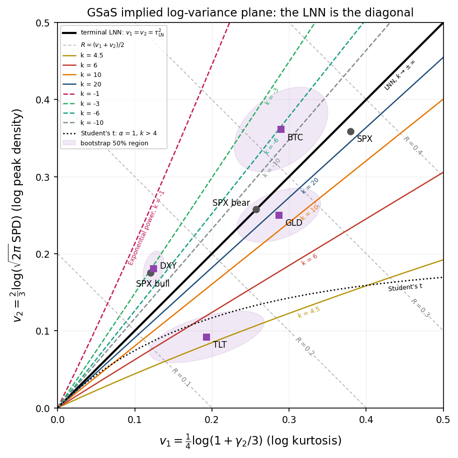
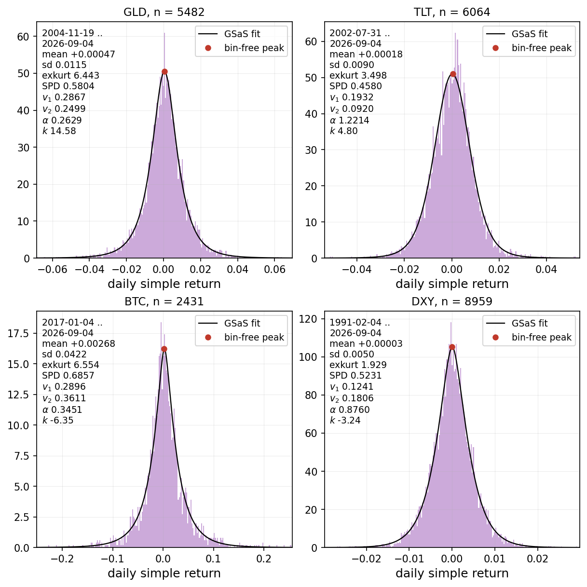
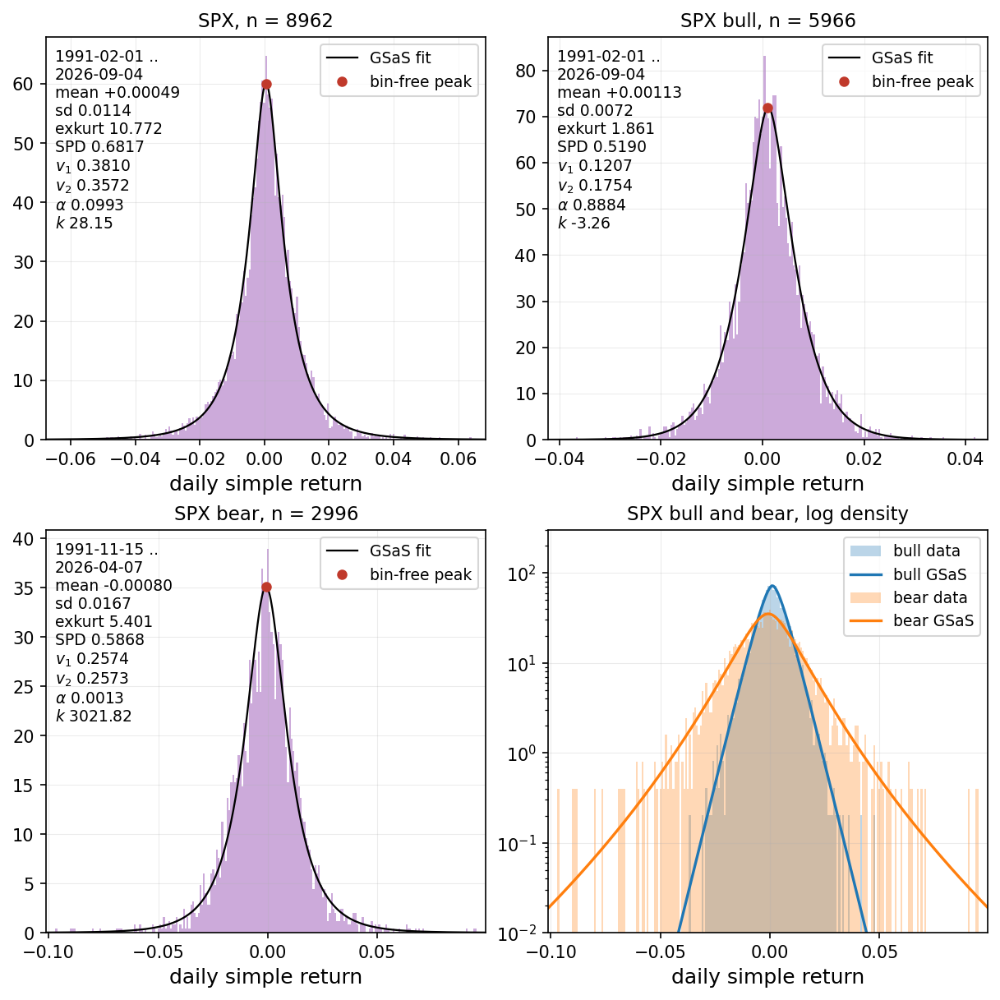
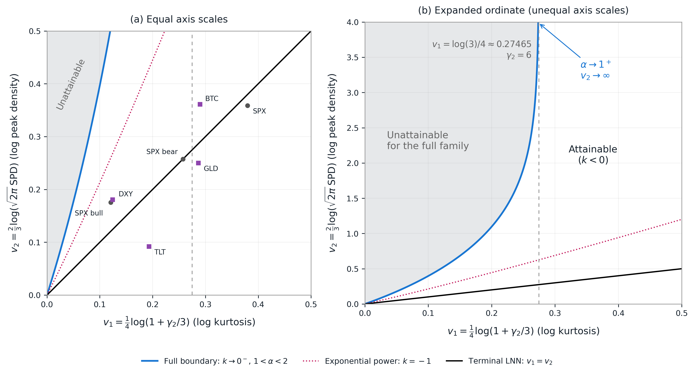
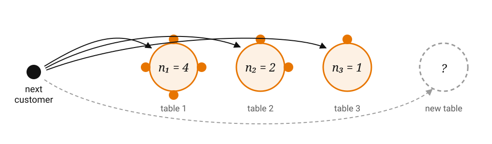
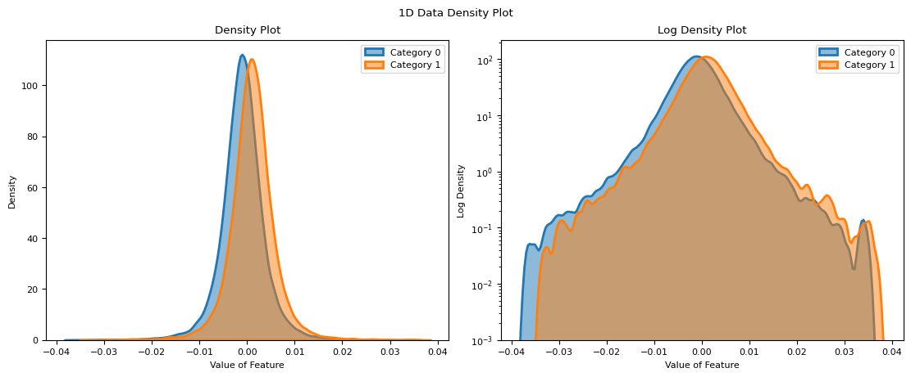
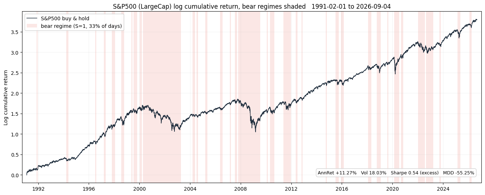
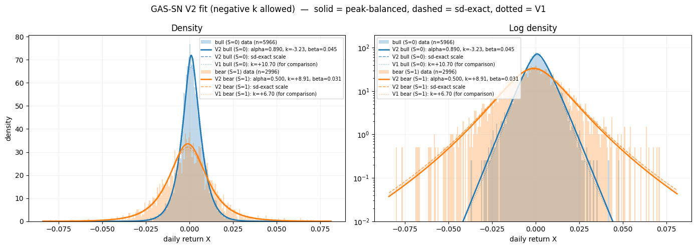
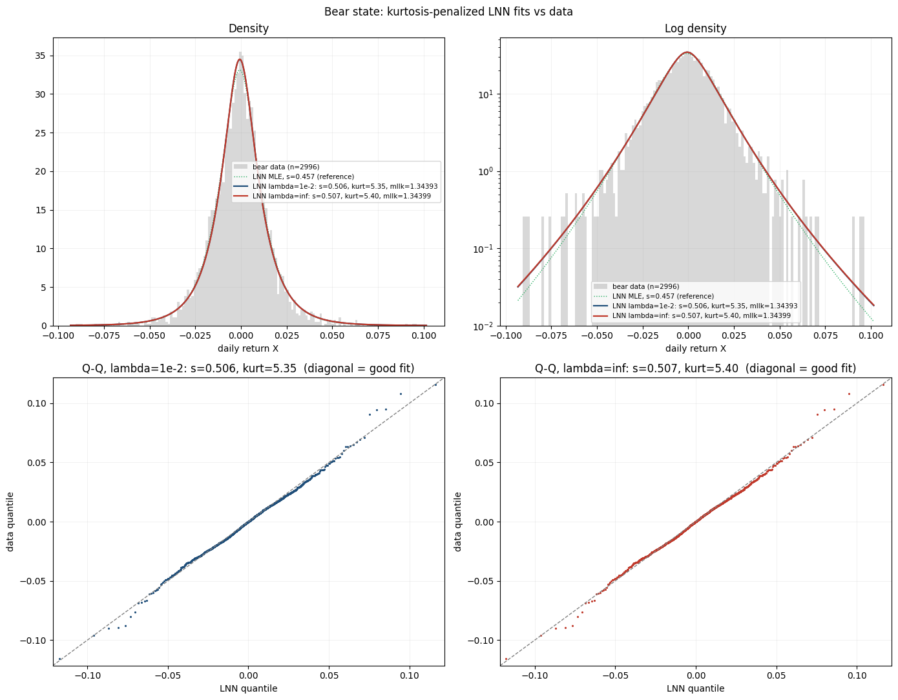

<!-- _class: lead -->

# The Fractional Distribution and Tilted Stable Law

## From the Chinese Restaurant to Synthetic Regime Data

## Stephen Lihn (2026)

Source: *Fractional Distributions* (fracdist) Reference implementation: `github.com/slihn/(gas-impl, Mixture-VAE)`

###  v109

---

## The challenge in financial time series

The series is often not long enough for machine learning models.
We need to use **synthetic** data for pre-training.

If we use the parametric model approach, we need a good parametric distribution.
Financial assets often show large kurtosis and sharp peak density.
It is hard to find the distribution that describes the **shape and moments** properly.

### Issues in the existing data generator for regime detection:

- Gaussian emissions make the problem **too easy** — every model wins.
- Student-*t* gives fat tails, but only **one** parameter (df) to tune.
- When tails are **too fat**, we need to clip the tails (clip_factor).

---

## Main results

Generalized $\alpha$-stable distribution (GAS)

- It **fits financial return data** well. Clipping is (almost) unnecessary.
- It can take on **any ticker** with 10-20 years of history!
- Its symmetric distribution (GSAS) has rich structures, akin to **Central Limit Theorem**
- It has an elegant connection to the **tilted stable law** (Pitman-Yor, Devroye, James)

Benchmarked the two-state result on Yuqi's regime-detection github project

- Mixture-VAE, Jump, KMeans++
- Achieved high accurancy

---

## GAS could be THE distribution family for asset returns

- This is a big claim !!! Will be explained in the next few slides with a focus on **GSAS**.
- Its parameters have meanings in classic statistical distribution.

### GSAS: symmetric, two shape parameters $(\alpha, k)$
- GSAS is a normal mixture: $\sim N / V$ where $V$ is the fractional chi (FCM) $\bar\chi_{\alpha, k}$.
- $\alpha$: stability index $(0,2]$, $k$: degrees of freedom $\in \mathbb{R}_{\ne 0}$, $\zeta=\operatorname{sign}(k)$
- $V$ is a squared tilted stable law $T$: $V\ \overset d=\ \sigma^\zeta T_{\alpha/2,z/2}^{-\zeta/2}$
  - $z = k-1$ when $k \ge 1$:  generalizes $\alpha$-stable, Student's t
  - $z = |k|$ when $k \le 0$: generalizes exponential power

### GAS-SN: GSAS + skew
- add $\beta$ from skew-normal $N \sim SN(\beta)$, generalizes skew-t

---

<table class="layout"><tr><td width="40%">

## GSAS version of CLT

### The canonical coordinates
X-axis: excess kurtosis
Y-axis: std peak density

- LNN limit $(k \to \pm\infty)$ at diagonal (thick black)
- Normal at origin
- Fits SPX, bull, bear
- Fits GLD, DXY, TLT, BTC

### Challenge
- In the small $\alpha$, large $k$ region
- Numerically harder

</td><td width="60%">

</td></tr></table>

---

<table class="layout"><tr><td width="40%">

## Fitting financial data becomes easy

- GLD, DXY, TLT, BTC
- Step 1: $(v_1, v_2) \to (\alpha, k)$
- Step 2: fits mean, sd

Then you can
- add skewness (GAS-SN)
- apply MLE

### Why does it work so well?
<small>It fits $\mathbb{E}[V^n]$ where $n = 1,-2,-4$</small>

</td><td width="60%">

</td></tr></table>

---

<table class="layout"><tr><td width="40%">

## Fitting financial data becomes easy

- SPX, bull, bear
- Two-regimes lower the kurtoses
- Bull at $k \approx -3$: thin tails
- Bear near/on the LNN terminal line

<small>Note: Study of the bear state led to
the LNN limit in 9/2026.</small>

</td><td width="60%">

</td></tr></table>

---

## GSAS has a very large admissible space

---

## The lognormal-normal (LNN) limit

Roughly speaking, let $k \to \pm\infty$ and $\alpha \to 0$ with $1/(\alpha |k|) \to \tau_{\mathrm{LN}}^2$ fixed.
Then the FCM $V \sim \bar\chi_{\alpha, k}$ has a lognormal limit:

$$\frac{V}{e^{\mathbb E[\log V]}} \xrightarrow{d} \operatorname{LogNormal}(0,\tau_{\mathrm{LN}}^2).$$

So GSAS $X = Z / V$ has an LNN limit after normalization:

$$X\thinspace e^{\mathbb E[\log V]} = \frac{Z}{V/e^{\mathbb E[\log V]}} \xrightarrow{d} Z\thinspace e^{\tau_{\mathrm{LN}} W} = \text{LNN}(\tau_{\mathrm{LN}}^2),$$

with $Z, W$ independent standard normals.

**A natural coordinate system**: the LNN is the diagonal, with $k>0$ below and $k<0$ above it.
The inverse degrees of freedom $\xi \approx 1/k$ is the signed distance from it: $\xi = 0$ is the LNN. 

---

## FCM's lognormal limit is a form of "tempered stable"

Near the lognormal limit, the centered log FCM, 

$$U = \log V - \mathbb E[\log V]$$ 

is approximated by a centered tempered stable law, with jump-magnitude Lévy measure

$$\nu_{U}(dr)=\delta \frac{e^{-\lambda r}}{r^(1+\alpha_{TS})} \thinspace dr, \quad r > 0$$

where $\alpha_{TS} = 1$, $\delta = 1/\alpha - 1/2$ and $\lambda \approx |k| \gg 1$. Jump direction: $-|k|$.

This is the so-called "Classic Tempered Stable" (CTS) distribution at index one.
Tempered stable law is frequently used in financial models.

(Massing 2024, Section 2.3) $\quad$ (Note: $\log V$ is additively infinitely divisible.)

---

## The two-parameter tilted stable law

It arose from Pitman & Yor's study of the **Poisson–Dirichlet** distribution. 

$$T^{-\alpha}_{\alpha,\beta} = \left(T_{\alpha,\beta}\right)^{-\alpha}$$

- $\alpha \in [0,1]$ — the **stability index**
- $\beta \ge 0$ — the power of the **polynomial tilt**
- $L_\alpha := T_{\alpha,0}$ — the one-sided stable law, often characterized by the Laplace transform:

$$\mathbb{E}\left[e^{-t L_\alpha}\right] = e^{-t^{\alpha}}, \qquad t \ge 0.$$

The **polynomial tilt $\beta$** is added to the density $L_\alpha(x)$ of $L_\alpha$ as

$$f_{T_{\alpha,\beta}}(x) \mskip5mu \propto\mskip5mu x^{-\beta} L_\alpha(x), \qquad x>0.$$

---

## Where it comes from - the single-parameter model

### The Chinese restaurant process (CRP), one customer at a time

Given $\alpha \in [0,1]$, $K_n$ tables occupied after $n$ customers; $n_j$ customers already at table $j$:

- Choose a large table to join? $\Pr(\text{join table } j) = \frac{n_j - \alpha}{n}$ $\longrightarrow$ Preferential attachment.
- Open a new table? $\Pr(\text{new table} \mid K_n) = \alpha \frac{K_n}{n}$ $\longrightarrow$ Diversity, creativity (or anti-social).
- The **$\alpha$-diversity limit** is $\frac{K_n}{n^{\alpha}} \longrightarrow M_{\alpha} := L^{-\alpha}_{\alpha}$ (the inverse stable law)

---

## The two-parameter Pitman-Yor process in CRP representation

$K_n$ tables occupied after $n$ customers; $n_j$ customers already at table $j$:

$$\Pr(\text{join table } j) = \frac{n_j - \alpha}{\beta + n}, \qquad
\Pr(\text{new table} \mid K_n) = \frac{\beta + \alpha K_n}{\beta + n}$$

- $\alpha$ plays a **discount** role — larger $\alpha$ discounts the pull of existing tables.
- $\beta$ is a **baseline strength** for creating a new table, independent of $n$ and $K_n$.

The **$\alpha$-diversity limit** is:

$$\frac{K_n}{n^{\alpha}} \longrightarrow T^{-\alpha}_{\alpha,\beta}$$

(Combinatorial Stochastic Processes, Pitman, 2002)

---

## The three-parameter tilted stable law: $\mathrm{TS}(\alpha,\beta,\gamma)$

The superscript (exponent) is generalized to $T^{-\gamma}_{\alpha,\beta}$ with $\gamma \in \mathbb{R}$ in Devroye (2009):

$$\mathrm{TS}(\alpha, \beta, \gamma) \mskip5mu :=\mskip5mu T^{-\gamma}_{\alpha,\beta} = (T_{\alpha,\beta})^{-\gamma}$$

- $\gamma > 0$ — represents a **local time** process
- $\gamma < 0$ — represents a **volatility** process

The **bridge** to the fractional distribution -
> "This three-parameter distribution law is **identical to our fractional gamma distribution** with a different parameterization."

---

## One foundational element, eight one-sided distributions

### $T_{\alpha,\beta}^{-\gamma}$ is the foundational **element** that builds all one-sided distributions.

| Fractional distribution | §     | Notation | $\alpha$ | $\beta$ | $\gamma$ | scale |
|---|---|---|---|---|---|---|
| One-sided stable | 4.2 | $L_\alpha$ (aka $T_{\alpha,0}$) | $\alpha$ | 0 | $-1$ | 1 |
| M-Wright / Mittag-Leffler | 3.4 | $M_\alpha$ | $\alpha$ | 0 | $\alpha$ | 1 |
| **Fractional gamma** | 6.5 | $N_\alpha(\sigma,d,p)$ | $\alpha$ | $\alpha d/p$ | $\alpha/p$ | $\sigma$ |
| **Fractional chi (FCM)** | 7.2.1 | $\bar{\chi}_{\alpha,k}$, $k>0$ | $\alpha/2$ | $(k{-}1)/2$ | $1/2$ | $\sigma_{\alpha,k}$ |
| Inverse FCM | 9.4 | $\bar{\chi}^{\dagger}_{\alpha,k}$ | $\alpha/2$ | $(k{-}1)/2$ | $-1/2$ | $\sigma^{-1}_{\alpha,k}$ |
| Characteristic FCM | 7.4.2 | $\bar{\chi}_{\alpha,-k}$ | $\alpha/2$ | $k/2$ | $-1/2$ | $\sigma^{-1}_{\alpha,k}$ |
| FCM2 | 7.6 | $\bar{\chi}^2_{\alpha,k}$ | $\alpha/2$ | $(k{-}1)/2$ | $1$ | $\sigma^2_{\alpha,k}$ |
| Characteristic FCM2 | 7.6 | $\bar{\chi}^2_{\alpha,-k}$ | $\alpha/2$ | $k/2$ | $-1$ | $\sigma^{-2}_{\alpha,k}$ |

* In the last line: $\bar{\chi}^2_{\alpha,-k}$ is $T_{\alpha/2,k/2}$. The reparametrization is most obvious here.

---

## FG: The fractional gamma — Overview (Ch. 6)

$$N_\alpha(x;\sigma,d,p) \mskip5mu :=\mskip5mu C\left(\frac{x}{\sigma}\right)^{d-1} F_\alpha\negthinspace \left(\left(\frac{x}{\sigma}\right)^{p}\right), \qquad x \ge 0$$

where $F_\alpha(x) := W_{-\alpha,0}(-x) = \alpha x M_\alpha(x)$ is the Wright function of the second kind.

- $\alpha \in [0,1]$ — shape of the Wright function
- $\sigma$ — scale; $p$ — tail shape ($p \neq 0$, $dp \ge 0$); $d$ — degrees of freedom

**FG is the fractional extension of the generalized gamma** $\text{GG}(a,d,p)$: replacing $e^{-(x/a)^p}$ by the Wright function $F_\alpha((x/\sigma)^p)$. GG is recovered at $\alpha = 0$, and — more usefully — at $\alpha = \tfrac12$, which is the line that "leads to the fractional extension of the $\chi$ distribution."

$$C = \frac{|p|}{\sigma}\thinspace \frac{\Gamma(\alpha d/p)}{\Gamma(d/p)} \quad (\alpha \neq 0,\thinspace d \neq 0)$$

---

## Fractional gamma *is* the tilted stable law (7/2026)

### The FG random variable is exactly the re-parametrized tilted stable variable.

Let $X \sim N_\alpha(\sigma,d,p)$. Then

$$\boxed{\mskip5mu X = \sigma\thinspace T^{-\alpha/p}_{\alpha,\mskip5mu \alpha d/p}\mskip5mu }$$

i.e. $\mskip5mu \beta = \alpha d/p\mskip5mu$ and $\mskip5mu \gamma = \alpha/p$.

* The polynomial tilt $\beta$ is the "degree of freedom" parameter in FG and $\chi$.

This mapping is an important finding. Everything downstream — FCM, FCM2, fractional $F$, GSaS, GAS-SN — inherits both its **analytics** (Mellin transform, moments) and its **sampler** from this one line.

---

## Sampling by modified Kanter's method (Lemma 6.2)

$$T_{\alpha,\beta} = A_\alpha(Q_\beta)\thinspace G_\beta^{-c}, \qquad c = \frac{1-\alpha}{\alpha}$$

1. $A_\alpha(q)$ — the **Zolotarev function**
2. $Q_\beta$ — the tilted angle, with density on $(0,1)$
$$f_{Q_\beta}(q) = I_\beta A_\alpha(q)^{-\beta}, \qquad I_\beta = \frac{\Gamma(1+\beta)\Gamma(1+c\beta)}{\Gamma(1+\beta/\alpha)}$$

3. $G_\beta \sim \mathrm{Gamma}(1 + c\beta,\ \text{scale}=1)$

Then the tilted stable variable $U$, and the FG variable $X$, are

$$U = T^{-\alpha}_{\alpha,\beta} = A_\alpha(Q_\beta)^{-\alpha}\thinspace G_\beta^{\thinspace 1-\alpha}, \qquad X = \sigma\thinspace U^{1/p}$$

**Two draws and a closed-form transform. No numerical CDF inversion. Fast.**

---

## FCM: The fractional $\chi$-mean (Ch. 7)

$$\bar{\chi}_{\alpha,k}(x) := N_{\alpha/2}\big(x;\ \sigma = \sigma_{\alpha,k},\ d = k-1,\ p = \alpha\big), \qquad
\sigma_{\alpha,k} = \frac{|k|^{1/2 - 1/\alpha}}{\sqrt{2}}$$

Apply $\beta = \alpha d/p$, $\gamma = \alpha/p$ with $\alpha \to \alpha/2$, $d = k-1$, $p = \alpha$:

$$\boxed{\mskip5mu \bar{\chi}_{\alpha,k} = \sigma_{\alpha,k}\thinspace T^{-1/2}_{\alpha/2,\ (k-1)/2}\mskip5mu }\qquad \text{(Sec. 7.2.1)}$$

which is exactly **the FCM row of Table 1**. 

Note $\alpha \in (0,2)$ here, while the element $T$ needs $\alpha \in (0,1)$ — the halving $\alpha \to \alpha/2$ is what reconciles them.

---

## The second element: Selective sampling

One-sided elements give tails. **Skewness needs a second mechanism** (§1.2, §14.4).

Take $X_0 \sim N_d(0,\bar\Omega)$, $X_1 \sim N(0,1)$, skew parameter $\beta \in \mathbb{R}^d$. 
The skew-normal (SN) variable is (Azzalini (2013))

$$Z = \begin{cases} X_0 & \text{if } X_1 > \beta^{\intercal} X_0 \cr -X_0 & \text{otherwise} \end{cases}
\qquad\Longrightarrow\qquad Z \sim SN_d(0,\bar\Omega,\beta)$$

A two-sided distribution is assembled as a **ratio** $Z / \mathrm{TS}(\cdot)$ or a **product** $Z \times \mathrm{TS}(\cdot)$.

The **crown jewel** is the **skew multivariate elliptical** distribution, based on the ratio

$$SN_d(0,\bar\Omega,\beta)/\bar{\chi}_{\alpha,k}.$$

---

## GAS-SN: The univariate two-sided skew distribution (Ch. 12)

Definition 12.1: Let $Z \sim SN(0,1,\beta)$ and $V \sim \bar{\chi}_{\alpha,k}$. Then

$$\boxed{\mskip5mu X = Z / V \mskip5mu \sim\mskip5mu L_{\alpha,k}(\beta)\mskip5mu , 
\quad \alpha \in (0,2], k \in \mathbb{R}, \beta \in \mathbb{R} }$$

$$\text{PDF:} \quad L_{\alpha,k}(x;\beta) = 2\int_0^\infty \mathcal{N}(xs)\thinspace \Phi_{\mathcal N}(\beta x s)\thinspace \bar{\chi}_{\alpha,k}(s)\thinspace s\thinspace ds$$

It is a **continuous mixture** — one skew-normal per value of the mixing variable $V$.

| Limit | Reduces to |
|---|---|
| $k=1, \beta = 0$ |  Paul Levy's original symmetric $\alpha$-stable dist |
| $\beta = 0$ |  The generalized symmetric $\alpha$-stable dist, called "GSaS", $L_{\alpha,k}$ |
| $\alpha = 1, k > 0$ | Azzalini's **skew-*t***: $T(\beta,k) = L_{1,k}(\beta)$ |
| $1/(\alpha \vert k \vert)$ fixed and $\vert k \vert \to \infty, \beta = 0$ | the lognormal-normal distribution (LNN) |
| $\alpha \to 2$ or $\vert k \vert \to \infty, \beta = 0$ | the normal distribution $\mathcal{N}(0,1)$ |

---

## From variates to to synthetic regime data

Yuqi's Mixture-VAE code base: (Nie, Mulvey, Poor, Yu & Huang (2026))

`data_code/synthetic_data.py :: generate_hmm_data(emission_dist='t', clip_factor= ...)`

**Goal:** The state labels are encrypted in the synthetic data via HMM. Model's job is to rediscover the labels.

---

## Mixture-VAE code base

1. **State path.** An `hmmlearn` `CategoricalHMM` with `emissionprob_ = I` emits the hidden path $\lbrace S_t\rbrace$ directly. E.g. Transition matrix `[[0.96, 0.04], [0.04, 0.96]]`, regimes persist ~25 days.
2. **Emissions** are **i.i.d. within a state** per state, at $\pm\text{loc}$.
4. **Draw per state.** For each state, draw exactly $\vert\lbrace t : S_t = j\rbrace\vert$ values — vectorized, in chunks.
5. **Clip by rejection.** Samples outside $\text{loc} \pm$ `clip_factor` $\times$ **scale** are rejected and redrawn.

**Why clip:** Undefined moments in small df for Student-*t*. Yuqi used `clip_factor=10.0`.

### **GAS-SN Enhancement** 

* `generate_hmm_data(emission_dist='gassn')` at `https://github.com/slihn/Mixture-VAE`

---

## Global regime - Bull/bear states by the jump model

Use the jump model to label the bull/bear states in the S&P500 daily return, $8{,}962$ days, $1991\text{–}2026$.

<table class="layout"><tr><td width="34%">

**Transition Matrix**

| | bull | bear |
|---|---|---|
| **bull** | 0.9940 | 0.0060 |
| **bear** | 0.0116 | 0.9884 |

stationary $(0.659,\thinspace 0.341)$

$\mathbf{35}$ **bear episodes** over $\mathbf{35}$ years

</td><td width="66%">

</td></tr></table>

---

## Global regime - GAS-SN fits of bull/bear states

Use MLLK to fit the data sets:

* **bull** in negative-*k*: generalized exponential power (thinner tails)
* **bear** in positive-*k*: generalized $\alpha$-stable. The large-k and low-alpha region was numerically hard.

| state | $\alpha$ | $k$ | $\beta$ | scale | loc | sd | $\kappa$ |
|---|---|---|---|---|---|---|---|
| **bull** ($S=0$), $66.6$% | $0.89$ | $\mathbf{-3.23}$ | $0.045$ | $0.00536$ | $+0.00089$ | $0.00722$ | $1.86$ |
| **bear** ($S=1$), $33.4$% | $0.50$ | $8.91$ | $0.031$ | $0.04556$ | $-0.00117$ | $0.01672$ | $5.41$ |

<small>The bear fit was capped at $\alpha = 0.5$ since the kurtosis is fully matched.
The MLE and moment-matching are not aligned.</small>

---

## Global regime - daily return histogram vs theoretical from fits

Simulating from the fits reproduces the real series on share and scale — bear share $0.337$ vs $0.334$.

<small>Pooled $\kappa$ is $8.42$ vs data's $10.77$, but that gap is **finite-sample noise, not a defect of either fit**: the bear state's 4th moment rides on a handful of extreme draws, and one fit returns $\kappa$ anywhere from $4.1$ to $8.1$ across draws.</small>

---

## Global regime - Fit the bear state with LNN

<table class="layout"><tr><td width="34%">

Use three methods to fit $\text{LNN}(\sigma^2)$:

1. Reference is MLE: $\sigma = 0.457$
2. MLE with some penalty to match $\kappa$: $\sigma = 0.506$
3. Full penalty to match $\kappa$ at 5.40: $\sigma = 0.507$

(2) and (3) are shown in Q-Q plots. They are straight lines. These are **good fits**. 

</td><td width="66%">

</td></tr></table>

---

## Global regime - New GAS-SN fit of the SPX data (9/2026)

<table class="layout"><tr><td width="34%">

The SPX fit is very good at $\alpha = 0.15, k = 19.9$. Notice the very small $\alpha$.

This fit was numerically impossible without the new log-inversion algorithm in PDF and CDF.

(SPX daily returns from 1/1990 to mid-2025)

</td><td width="66%">

</td></tr></table>

---

## Cluster distance — separation between the two states

$$\text{cluster distance} = \frac{|\mathrm{median}_1 - \mathrm{median}_0|}{\mathrm{MAD}},$$

$$\text{where} \quad \mathrm{MAD} = 1.4826\thinspace \mathrm{median}\big(|x - \mathrm{median}(x)|\big).$$

A better measure of the separation between the two states. It is like the loc/sd, but built from medians — It always exists, and **fat tails cannot move it**. 

Rationale: Inside Yuqi's code, $X$ is z-scored before building a feature, so **only the ratio reaches the model**.

---

## Global regime - model output

$$\textbf{Cluster distance is only } 0.254 \textbf{ MAD — yet Jump scores } 0.92.$$

Feeding those emissions and that transition matrix through the same comparator, $T = 100{,}008$:

| model | Accuracy |
|---|---|
| **Jump** | $\mathbf{0.9246}$ |
| Mixture-VAE | $0.8613$ |
| KMeans++ | $0.8269$ |
| Gaussian-HMM | $0.5000$ |

- All three ML models score very high.
- **HMM fails outright** ($0.5000$, "model is not converging"), rather than merely trailing.
- Jump ran at `jump_penalty` $=100$ to match the original notebook.
- Emissions clipped at $\pm 20$ **sd**. 

---

## Summary on global regime

- Used the jump model to label the bull/bear states since 1991. $35$ bear episodes.
- Fit each state with GAS-SN. Two versions are provided.
- The bear state appears to approach an LNN limit.
- Used GAS-SN as the emission distribution to generate synthetic data.
- Ran four models (Jump, KMeans++, Mixture-VAE, HMM) to label the synthetic data.
- ML model accuracy is high. Jump stands out at $0.92$. HMM fails at $0.50$.
- A smaller cluster distance is not an obstacle.

$$\textbf{These states separate by scale, in addition to opposite locations.}$$

---

## References

- **fracdist** — *Fractional Distributions*, Ch. 1.2 (elements & Table 1), Ch. 6 (FG and the inverse tilted stable law), Ch. 7 (FCM), Ch. 12 (GAS-SN). `github.com/slihn/gas-impl/tree/main/docs`
- Pitman & Yor — Poisson–Dirichlet, the two-parameter CRP, and the $\alpha$-diversity limit.
- Devroye / Kanter / Zolotarev — the stable-law sampling representation behind Lemma 6.2.
- Azzalini (2013) — the skew-normal and skew-*t* blueprint (selective sampling, $SN_d$).
- Nie, Mulvey, Poor, Yu & Huang (2026) — *Deep generative models meet statistical methods: a generalized framework for financial regime identification*, **Annals of Operations Research** (in press). Code: `github.com/yuqinie98/Mixture-VAE` — the model and benchmark this work builds on.

